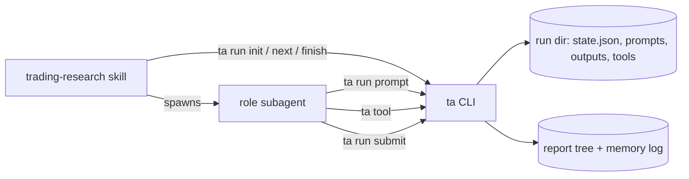

# trading-agent-skills

[TradingAgents](https://github.com/TauricResearch/TradingAgents)' multi-agent research pipeline, rebuilt as **Agent Skills** that run in Claude Code, Codex or omp. Four analysts, a bull/bear debate, a research manager, a trader, a three-way risk debate and a portfolio manager produce a rating, a price target and a full report for one ticker and date. A memory log settles past decisions against realized returns and feeds reflections into later runs.

## Relation to TradingAgents

This is a port of the TradingAgents research logic (prompts, state transitions, data routing, report layout, memory log) from LangGraph to skills. Prompts are carried over verbatim; the LangGraph/LangChain stack and the LLM client layer are gone because the agent runtime now does the reasoning. Credit to the TradingAgents authors; both projects are Apache-2.0 (see `LICENSE`).

## Architecture

| layer | what | where |
|---|---|---|
| Skills | one orchestrator (`trading-research`) and 13 role skills (4 analysts, bull, bear, research manager, trader, 3 risk analysts, portfolio manager, decision reflection). Each role renders its prompt, reasons, and submits output. | `skills/*/SKILL.md`, prompt templates in `skills/*/prompt*.md` |
| `ta` CLI | deterministic Python: data tools, run state machine and routing, prompt rendering, output validation, report writing, memory log | `src/ta_skills` |
| Subagents | Claude Code subagent per role (`sonnet` quick tier, `opus` deep tier) | `.claude/agents/` |

`.claude/skills` and `.agents/skills` are symlinks to `skills/`, so Claude Code, omp and Codex find the same skills.



The orchestrator only loops `ta run next`: analysts and memory in parallel, then research debate, research manager, trader, risk debate, portfolio manager, one role at a time, then `ta run finish`. The CLI owns routing (debate budgets, speaker order), so agents cannot skip or reorder steps.

### Run directory

`~/.tradingagents/runs/<TICKER>/<YYYY-MM-DD>_<HHMMSS>/` holds `state.json` (the TradingAgents `AgentState` fields plus a `run` block), `prompts/` (every rendered prompt), `outputs/` (every accepted submission) and `tools/` (every tool call and result). Treat it as read-only for agents and users; the CLI owns it.

### Report

`ta run finish` writes the TradingAgents report tree: `<reports_dir>/<TICKER>/<YYYYMMDD>_<model_label>_<YYYYMMDD>_<HHMMSS>/` with stage folders `1_analysts` to `5_portfolio`, `complete_report.md` and `complete_report.html`. It also writes the state log under `results_dir` and records the decision in the memory log.

The `trading-research` skill writes reports into this repo's `docs/` (override with `TRADINGAGENTS_REPORTS_DIR`) and then runs `scripts/report_workflow.py`, which regenerates the MkDocs site exactly as TradingAgents does: `docs/index.md` with daily decision summaries, one hub per ticker at `docs/<TICKER>/index.md`, and a strict build into `_site/`. Preview with `uv run mkdocs serve`. Report Markdown and the derived pages are gitignored, as in TradingAgents.

## Install

Requires Python 3.11+ and [uv](https://docs.astral.sh/uv/).

```bash
git clone <this repo> && cd trading-agent-skills
uv sync --extra docs   # dev tools (ruff, pytest) come with every uv sync / uv run
uv run ta --help
```

Plus at least one agent runtime: [Claude Code](https://claude.com/claude-code), [Codex CLI](https://github.com/openai/codex) or [omp](https://github.com/can1357/oh-my-pi).

## Usage

### Interactive

Start the runtime in this repo and ask for a run:

- Claude Code: `claude`, then "Use the trading-research skill on NVDA for 2026-10-28, depth 2". Role subagents come from `.claude/agents`.
- omp: `omp` in the repo, same request; the orchestrator launches one `omp -p` per role (`openai-codex/gpt-6.1-sol`, thinking `low` quick, `high` deep).
- Codex: `codex` in the repo, same request; the orchestrator launches one `codex exec` per role (`gpt-6-luna` quick, `gpt-6.1-sol` deep).

Orchestrator inputs: ticker (required), date (default today), analysts (default `market,sentiment,news,fundamentals`), depth (debate and risk rounds, default 1), language, portfolio file, model label.

### Headless

```bash
scripts/research.sh NVDA                                   # today, Claude Code, depth 1
scripts/research.sh NVDA 2026-10-28 --runtime codex --depth 2
scripts/research.sh 0700.HK --runtime omp
```

The script runs the orchestrator through `claude -p` (permission mode `dontAsk`, tools allow-listed), `codex exec` (`workspace-write` sandbox with network, writable `~/.tradingagents` and `~/.codex`) or `omp -p`. If you move run or report dirs outside `~/.tradingagents` via env vars, grant the runtime write access to them.

### Driving the CLI by hand

`ta run init`, `ta run next`, `ta run prompt`, `ta tool`, `ta run submit`, `ta run finish`, `ta memory due|resolve`, `ta eval pull|report`. `uv run ta tool list` shows the 12 data tools and their parameters.

## Configuration

Defaults live in `src/ta_skills/config.py`; environment variables override them (put them in `.env`).

| variable | meaning |
|---|---|
| `TRADINGAGENTS_OUTPUT_LANGUAGE` | report language |
| `TRADINGAGENTS_MAX_DEBATE_ROUNDS`, `TRADINGAGENTS_MAX_RISK_ROUNDS` | debate depth (bull/bear budget is 2x, risk budget 3x) |
| `TRADINGAGENTS_MAX_TOOL_ROUNDS` | tool calls per analyst before wrap-up |
| `TRADINGAGENTS_BENCHMARK_TICKER` | benchmark for alpha in memory settlement |
| `TRADINGAGENTS_SENTIMENT_INCLUDE_REDDIT` | include Reddit in sentiment inputs |
| `TRADINGAGENTS_RUNS_DIR`, `_REPORTS_DIR`, `_RESULTS_DIR`, `_CACHE_DIR`, `_MEMORY_LOG_PATH`, `_EVAL_DIR` | storage paths (default under `~/.tradingagents`) |
| `TRADINGAGENTS_SITE_REPO` | TradingAgents checkout whose `gh-pages` branch holds the published reports, for `ta eval pull` |
| `ALPHA_VANTAGE_API_KEY`, `FRED_API_KEY`, `SEC_EDGAR_USER_AGENT`, `TYPESAFE_API_KEY` | optional data vendor keys; Yahoo, Polymarket, Reddit and StockTwits need none |

## Memory log

Every finished run stores its decision in `memory_log_path` (default `~/.tradingagents/memory/trading_memory.md`). At the start of each later run the `memory` role (`decision-reflection`) calls `ta memory due`: for decisions whose holding window has traded, the CLI computes raw and benchmark-relative return and the agent writes a reflection, stored with `ta memory resolve`. The portfolio manager's prompt receives the resulting past context.

## Forecast evaluation

`ta eval` measures how accurate published decisions turned out to be once the market has moved past them. It reads the record from the TradingAgents site's deploy branch, not from local report Markdown:

```bash
uv run ta eval pull --repo ~/my-code/TradingAgents   # fetch origin/gh-pages; append new runs to the ledger
uv run ta eval report [--as-of YYYY-MM-DD]           # price every forecast; write the scorecard
```

- `pull` fetches only the remote-tracking branch, leaving the checkout's working tree untouched. It appends each run's final decision (rating, reported price, price target, confidence, time horizon) to `<eval_dir>/forecasts.jsonl`. A run path never changes, so a forecast can't be rewritten once it has been scored.
- `report` follows the memory-settlement conventions: entry is the first close after the analysis date; a horizon is scored only after its whole window has traded on or before `--as-of` (default yesterday); returns use adjusted closes; alpha is measured against the regional benchmark. It skips runs generated after the entry session and keeps the newest rerun for each ticker, model and date.
- The scorecard (`scorecard.md`, `scorecard.json`, plus `outcomes.csv` per forecast) covers 5, 21, 63, 126 and 252 trading days. For ratings it reports per-date rank IC with a block-bootstrap interval and a permutation p-value, hit rates, the long–short spread, a momentum baseline, IC within each ticker, and a breakdown by model and by confidence. For price targets it reports skill against a random walk at the start and end of the declared horizon, along with calibration slope and touch rate, and the skill of walk-forward shrunk targets (each target's move scaled by a factor fitted only on windows already closed) to tell direction from size. It also checks integrity: whether the reported price matches the actual close, and whether the target points the same way as the rating.

## Development

```bash
uv run ruff check .
uv run pytest -q                 # network tests are marked `integration` and skipped by default
```

See `AGENTS.md` for repo rules. Output is research material, not investment advice.
