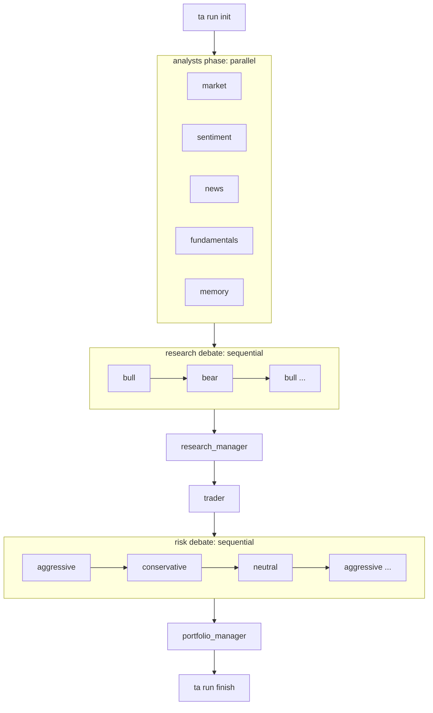

# Trading Research (orchestrator)

Runs the TradingAgents pipeline as a team of role subagents. You only sequence the run; every role's reasoning happens in its own subagent, and every state change goes through `uv run ta ...`. Run all commands from the repository root.

## Inputs

| input | default | maps to |
|---|---|---|
| ticker | required | `--ticker` |
| date | today (`YYYY-MM-DD`, not in the future) | `--date` |
| analysts | `market,sentiment,news,fundamentals` | `--analysts` |
| depth | 1 | `--depth` (debate rounds and risk rounds) |
| language | English | `--language` |
| portfolio file | none | `--portfolio FILE` |
| model label | name of the model you run on | `--model-label` (also `--provider`, `--deep-model`, `--quick-model` if known) |

Ask only for the ticker if it is missing; use defaults for the rest.

## Pipeline



## Procedure

1. `uv run ta run init --ticker T --date D [--analysts ...] [--depth N] [--language L] [--portfolio FILE] [--model-label L]`. It prints the run directory: call it `RUN` (absolute path).
2. Loop: `uv run ta run next --run RUN` prints `{"phase": ..., "roles": [...]}`.
   - `done`: leave the loop.
   - otherwise spawn one subagent per listed role (see "Spawning"), wait until all of them finish, then call `next` again. `next` is the only source of truth for what runs; never decide the order yourself.
3. `uv run ta run finish --run RUN --reports-dir "${TRADINGAGENTS_REPORTS_DIR:-docs}"` prints JSON `{"report_dir", "complete_report", "rating"}`. The report lands in the repo's `docs/<TICKER>/<run>/` site tree unless `TRADINGAGENTS_REPORTS_DIR` is set.
4. If the report landed under `docs/`: `uv run python scripts/report_workflow.py --analysis-date YYYYMMDD --allow-incomplete` (the run's date) to regenerate `docs/index.md` and the ticker hub and compile `_site/`. A validation failure means the report is missing a decision field: report the error.
5. Final answer: the rating, the price target (read it from `complete_report`, portfolio manager section), the one-line thesis from the decision summary, and the report path. Do not paste the report.

## Spawning

Role to skill: market=`market-analyst`, sentiment=`sentiment-analyst`, news=`news-analyst`, fundamentals=`fundamentals-analyst`, bull=`bull-researcher`, bear=`bear-researcher`, research_manager=`research-manager`, trader=`trader`, aggressive=`aggressive-risk-analyst`, conservative=`conservative-risk-analyst`, neutral=`neutral-risk-analyst`, portfolio_manager=`portfolio-manager`, memory=`decision-reflection`.

Tier: `research_manager` and `portfolio_manager` are deep; every other role is quick.

Give each subagent only: the role id, the skill name and `RUN`. Instruction text: `Use the <skill> skill. Run dir: <RUN>. Role: <role>.` Do not summarize or forward other roles' outputs: the rendered prompt already carries what the role may see.

### Claude Code

Use the Agent (Task) tool with `subagent_type` = the skill name (the `.claude/agents/<skill>.md` definitions pin `sonnet` for quick roles and `opus` for deep roles). Issue all calls of a phase in one message so they run in parallel.

### omp

omp's `task` tool cannot set a subagent's model, so run one `omp -p` per role from the repo root, quick roles with `--thinking low`, deep roles with `--thinking high`, both on `openai-codex/gpt-6.1-sol` (Artificial Analysis Finance & Accounting index on par with Claude Code's `sonnet`/`opus` tiers at a fraction of the cost):

```bash
omp -p --no-session --cwd "$PWD" --model openai-codex/gpt-6.1-sol --thinking low \
  "Use the market-analyst skill. Run dir: $RUN. Role: market." > "$RUN/drafts/market.omp.log" 2>&1 &
```

Background jobs and `drafts/` work as in the Codex section below.

### Codex

Run one `codex exec` per role from the repo root, quick roles with `-m gpt-6-luna`, deep roles with `-m gpt-6.1-sol`:

```bash
codex exec -m gpt-6-luna -s workspace-write \
  -c sandbox_workspace_write.network_access=true --add-dir "$HOME/.tradingagents" --add-dir "$HOME/.codex" \
  "Use the market-analyst skill. Run dir: $RUN. Role: market." > "$RUN/drafts/market.codex.log" 2>&1 &
```

Start every role of an `analysts` phase as a background job and `wait` for all of them; run single-role phases in the foreground. (`mkdir -p "$RUN/drafts"` first.)

## Parallelism rules

- `analysts` phase: all listed roles in parallel, including `memory`.
- Every other phase lists exactly one role: run it alone and wait for it. Debates are strictly sequential: each speaker's prompt depends on the previous speech.
- One role per spawn; never batch two roles into one subagent.

## Failure handling

- After a phase, `ta run next` still lists a role that was spawned: it exited without submitting. Re-spawn that role once. If it still does not submit, stop and report the role and its last error.
- Never write a role's output yourself, never call `ta run submit` for a role, never edit anything under `RUN` (especially `state.json`). Roles are the only writers.
- `ta run init` or `finish` failures (bad date, unknown ticker, vendor error): report the error text and stop.

## Rules

- Never change the ticker or date after init. One run directory per run; never reuse a run directory for a different ticker.
- No web search and no other skills while orchestrating.
